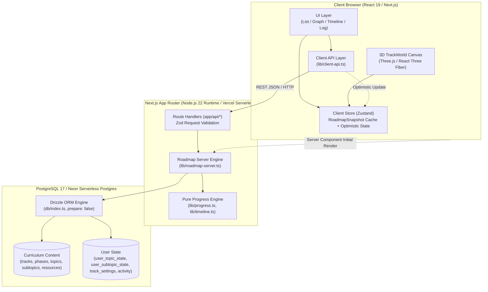
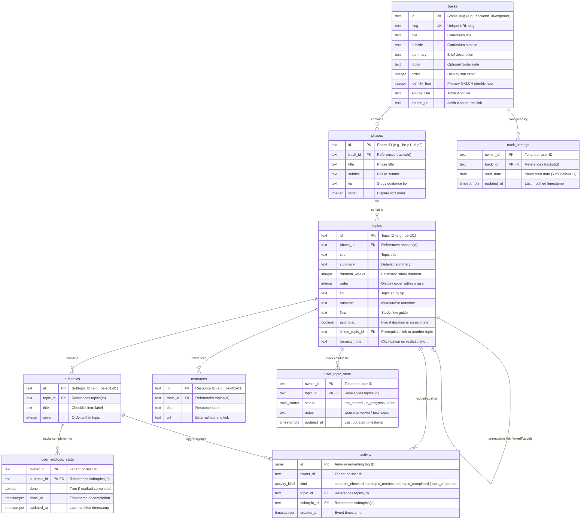
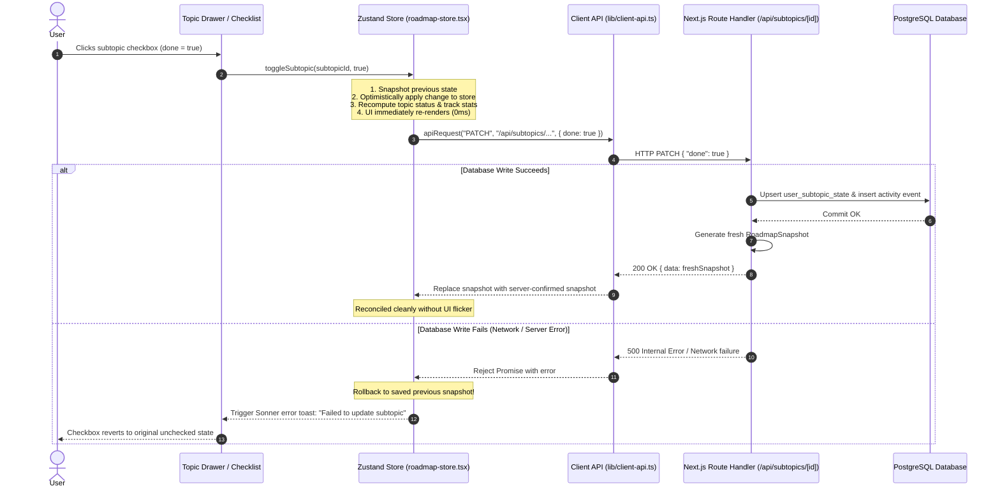
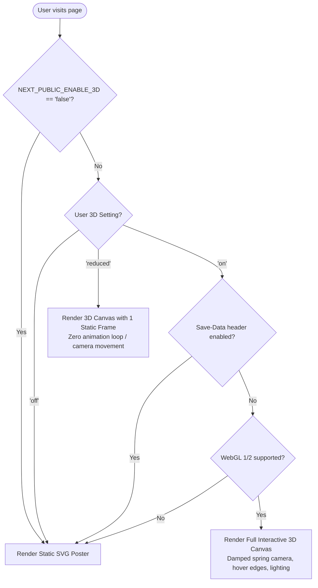

# System Architecture & Design Deep Dive

This document details the internal design, domain model, state synchronization patterns, and technical decisions behind the **Backend Roadmap Tracker**.

---

## Table of Contents

- [1. Architectural Overview](#1-architectural-overview)
- [2. Architectural Principles](#2-architectural-principles)
- [3. Component Architecture](#3-component-architecture)
- [4. Data Architecture & Content/State Split](#4-data-architecture--contentstate-split)
  - [4.1 Database Entity-Relationship Diagram](#41-database-entity-relationship-diagram)
  - [4.2 Table Definitions](#42-table-definitions)
- [5. State Management & Optimistic Synchronization](#5-state-management--optimistic-synchronization)
  - [5.1 Single Snapshot Pattern](#51-single-snapshot-pattern)
  - [5.2 Optimistic Mutation Lifecycle](#52-optimistic-mutation-lifecycle)
- [6. Multi-Track & Cross-Topic Mirroring](#6-multi-track--cross-topic-mirroring)
- [7. 3D TrackWorld Rendering Engine](#7-3d-trackworld-rendering-engine)
  - [7.1 Fallback Ladder](#71-fallback-ladder)
  - [7.2 Performance Gating](#72-performance-gating)
- [8. Design Token Compilation & Guardrails](#8-design-token-compilation--guardrails)
- [9. Architecture Decision Records (ADRs)](#9-architecture-decision-records-adrs)

---

## 1. Architectural Overview

Backend Roadmap Tracker is built with a **local-first, server-authoritative** architecture designed around immutable curriculum content and high-speed derived states.



---

## 2. Architectural Principles

1. **Curriculum as Code, Never as Hand-Entered Tasks**: The curriculum is an engineering field manual defined in typed TypeScript files (`content/tracks/`) and seeded into PostgreSQL. Re-seeding updates titles, tips, and resources without wiping user progress.
2. **Single Snapshot Source of Truth**: All views (Roadmap List, React Flow Graph, 36-Week Timeline, Field Log, and 3D TrackWorld) derive their state from a single consolidated data structure: `RoadmapSnapshot`.
3. **Instantaneous UI with Guaranteed Rollback**: Ticking a subtopic or updating notes updates client UI state within 0ms. If the network or database write fails, the UI rolls back cleanly to the pre-mutation snapshot and informs the user via Sonner toasts.
4. **Tenant Isolation via Scoped Owner ID**: While currently configured for guest-first single users (`owner_id = "guest-local"`), every state table is composite-keyed with `owner_id`. Supporting multi-tenant authentication in the future requires modifying `lib/owner.ts` without altering a single database migration.
5. **No Runtime Theme Calculation**: Themes (Black, Purple, Light) use strict OKLCH tokens compiled into static CSS custom properties (`app/themes.css`). Zero hardcoded hex colors exist in UI components; tests fail in CI if any literal hex/rgb escapes token boundaries.

---

## 3. Component Architecture

```
app/
├── (product)/
│   ├── [track]/                   # Track routes (/backend, /ai-engineer)
│   │   ├── page.tsx               # Main Roadmap (List / Graph views)
│   │   ├── log/page.tsx           # Field Log & Activity Dashboard
│   │   ├── timeline/page.tsx      # 36-Week Timeline & Start Date Projection
│   │   └── layout.tsx             # Track layout with TrackShellBoundary
│   ├── journey/page.tsx           # Unified cross-track journey overview
│   └── settings/page.tsx          # Settings screen (themes, 3D preferences, data)
├── api/                           # Typed REST API endpoints (Zod-validated)
│   ├── roadmap/route.ts           # GET current RoadmapSnapshot
│   ├── subtopics/[subtopicId]/    # PATCH toggle subtopic completion
│   ├── topics/[topicId]/          # PATCH update topic notes / manual status
│   ├── settings/route.ts          # PATCH set track start date
│   ├── export/route.ts            # GET download progress JSON file
│   ├── import/route.ts            # POST restore progress JSON file
│   └── reset/route.ts             # POST wipe user progress for track
├── layout.tsx                     # Global HTML shell, theme scripts, fonts
└── page.tsx                       # Landing page with interactive TrackWorld & track picker
```

---

## 4. Data Architecture & Content/State Split

A clean boundary separates immutable syllabus content from mutable user study history:

```
               +-----------------------------+
               | Immutable Curriculum Content|
               | (tracks, phases, topics,    |
               |  subtopics, resources)      |
               +--------------+--------------+
                              |
               +--------------v--------------+
               |    Mutable User Progress    |
               | (user_topic_state,          |
               |  user_subtopic_state,       |
               |  track_settings, activity)  |
               +-----------------------------+
```

### 4.1 Database Entity-Relationship Diagram



### 4.2 Table Definitions

| Table                 | Kind       | Purpose                                                                              |
| :-------------------- | :--------- | :----------------------------------------------------------------------------------- |
| `tracks`              | Content    | Holds curriculum track definitions, identity hues, and source attribution.           |
| `phases`              | Content    | Groups curriculum topics into structured progressive phases.                         |
| `topics`              | Content    | Syllabus topics with estimated week durations and prerequisite pointers.             |
| `subtopics`           | Content    | Granular actionable checklist items per topic.                                       |
| `resources`           | Content    | Curated documentation, book, and video links per topic.                              |
| `user_topic_state`    | User State | Holds manual status overrides and notes, composite-keyed by `(owner_id, topic_id)`.  |
| `user_subtopic_state` | User State | Tracks checked/unchecked state and completion dates per user subtopic.               |
| `track_settings`      | User State | Stores the user's start date per track for timeline projections.                     |
| `activity`            | User State | Append-only event log used to calculate daily study streaks and the 12-week heatmap. |

---

## 5. State Management & Optimistic Synchronization

### 5.1 Single Snapshot Pattern

The server constructs a `RoadmapSnapshot` through a single batched query in `lib/roadmap-server.ts`:

1. Fetches content rows (`tracks`, `phases`, `topics`, `subtopics`, `resources`).
2. Fetches user progress for the current `owner_id`.
3. Inverts links: merges prerequisite status from linked topics.
4. Computes high-level derivations: overall completion percentages, completed weeks, current topic pointer.
5. Returns `RoadmapSnapshot` to hydrate the client store.

### 5.2 Optimistic Mutation Lifecycle



---

## 6. Multi-Track & Cross-Topic Mirroring

The app supports multiple tracks simultaneously:

- **Backend Engineer**: 4 phases, 11 topics, 52 subtopics, 36 weeks.
- **AI Engineer**: 5 phases, 28 topics, 98 subtopics, 28 weeks.

### Prerequisite Linking Mechanism

The AI Engineer track begins with foundational software engineering topics that map directly to the Backend track. Rather than duplicating work:

- AI topics set `linkedTopicId` pointing to the corresponding `topics.id` in the Backend track.
- `lib/roadmap-server.ts` checks the user's progress on the linked Backend topic.
- If the Backend topic is marked completed, the AI topic displays a **Mirrored Status** (`mirrored: true`).
- The user can optionally override the mirrored status directly with a manual override ("I already know this"), stored in `user_topic_state`.

---

## 7. 3D TrackWorld Rendering Engine

The landing page and Journey view feature **TrackWorld**, an interactive 3D procedural desk model rendered with Three.js, React Three Fiber, and @react-three/drei.

### 7.1 Fallback Ladder

3D rendering degrades gracefully according to client device capabilities and user preference:



### 7.2 Performance Gating

- Weak hardware concurrency (`navigator.hardwareConcurrency <= 4`) automatically dials back Device Pixel Ratio (DPR) and point density via `@react-three/drei`'s `PerformanceMonitor`.
- Every `<canvas>` element is marked `aria-hidden="true"`, with an accessible semantic DOM alternative rendered side-by-side.

---

## 8. Design Token Compilation & Guardrails

The project enforces an engineer's field manual aesthetic (graphite surfaces, flat phase tints, mono data type):

1. **Single Source of Truth**: All colors are specified in `lib/theme/tokens.ts` using modern `oklch(...)` notation.
2. **Deterministic Code Generation**: Running `npm run tokens` executes `scripts/generate-themes.ts`, rendering:
   - `app/themes.css`: CSS custom properties for `black`, `purple`, and `light`.
   - `app/icon.svg`: Dynamic SVG favicon rendered with corresponding brand colors.
3. **CI Color Guardrail**: `scripts/check-theme-colors.mjs` scans all application code. If a hardcoded hex code (e.g., `#ffffff`), `rgb()`, or default Tailwind palette class (e.g., `bg-blue-500`) is detected outside `lib/theme/`, the test suite fails immediately.

---

## 9. Architecture Decision Records (ADRs)

Key architectural decisions are preserved in `docs/adr/`:

- [ADR 0002: Multi-Track Architecture](file:///c:/projects/Backend-Roadmap/docs/adr/0002-multi-track.md) — Multi-track syllabus modeling and database normalization.
- [ADR 0003: TypeScript-Only Content & 3D Visualizer](file:///c:/projects/Backend-Roadmap/docs/adr/0003-ts-only-and-3d.md) — Why curriculum is maintained in typed TS files rather than raw markdown.
- [ADR 0004: Interactive 3D Scene Art Direction](file:///c:/projects/Backend-Roadmap/docs/adr/0004-interactive-3d.md) — Three.js rendering conventions and anti-slop guidelines.
- [ADR 0005: Theme System Architecture](file:///c:/projects/Backend-Roadmap/docs/adr/0005-theme-system.md) — OKLCH token compilation and WCAG AA contrast enforcement.
- [ADR 0006: Exploded Stack Interaction](file:///c:/projects/Backend-Roadmap/docs/adr/0006-exploded-stack.md) — Layered DOM/CSS 3D architectural overview on the landing page.
- [ADR 0007: Missing Theme Root Cause Analysis](file:///c:/projects/Backend-Roadmap/docs/adr/0007-missing-theme-rca.md) — Incident report and regression tests for theme switching.
